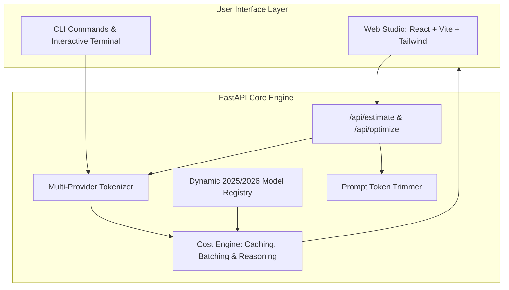

# LLM Cost Calculator & Studio

[](https://github.com/utkarshk0509/llm-cost-calculator/actions/workflows/ci.yml)

A full-stack application and developer CLI to estimate token counts, model pricing, prompt caching savings, and batch discounts across 17+ leading LLMs from OpenAI, Google, Anthropic, DeepSeek, Meta, and Mistral.

---

## 🚀 Features

* **Full-Stack Web App Studio**: Modern React + Vite + Tailwind interface for live prompt editing and real-time cost comparison.
* **17+ Flagship & Cost-Efficient Models**: Gemini 2.5 Pro/Flash, Claude 3.7 Sonnet, GPT-4o, o3-mini, o1, DeepSeek V3/R1, Llama 3.3, and more.
* **Accurate Multi-Provider Token Counting**: Model-family tailored token approximations with `tiktoken` (`o200k_base`).
* **Prompt Caching & Batch API Discounts**: Simulate Claude 90% cache read discounts, Gemini context caching, and 50% batch off-peak discounts.
* **Reasoning / Thinking Tokens**: Accurately calculate costs for reasoning models (Claude 3.7 Thinking Mode, OpenAI o1/o3-mini, DeepSeek R1).
* **Prompt Optimizer**: Scans for conversational boilerplate, extra whitespace, and duplicate instructions with 1-click token trimming.
* **Interactive CLI & Headless API**: Use the fast CLI or consume the REST API (`/api/estimate`, `/api/models`, `/api/optimize`).
* **Exporting**: Export side-by-side cost comparisons directly to CSV or copy clean markdown summaries.

---

## 📐 Architecture



---

## 🛠️ Installation

```bash
git clone https://github.com/utkarshk0509/llm-cost-calculator.git
cd llm-cost-calculator
pip install -e .
```

---

## 🌐 Launching the Full-Stack Web App

Launch the web studio directly:

```bash
llm-cost ui
# or
llm-cost server --port 8000
```

Open [http://localhost:8000](http://localhost:8000) in your browser.

### Development Mode (Vite Hot-Reload)

```bash
# Terminal 1: Backend
python -m src.server

# Terminal 2: Frontend
cd frontend
npm run dev
```

---

## 💻 CLI Usage

### 1. Interactive Terminal Mode
```bash
llm-cost interactive
```

### 2. Estimate a prompt directly
```bash
llm-cost estimate --prompt "Summarize this git diff and extract security fixes." --output 300 --calls 500
```

### 3. Estimate a codebase or directory of files
```bash
llm-cost estimate --path ./src --output 1000 --calls 100
```

---

## 🧪 Testing & Linting

```bash
pytest
ruff check .
```
